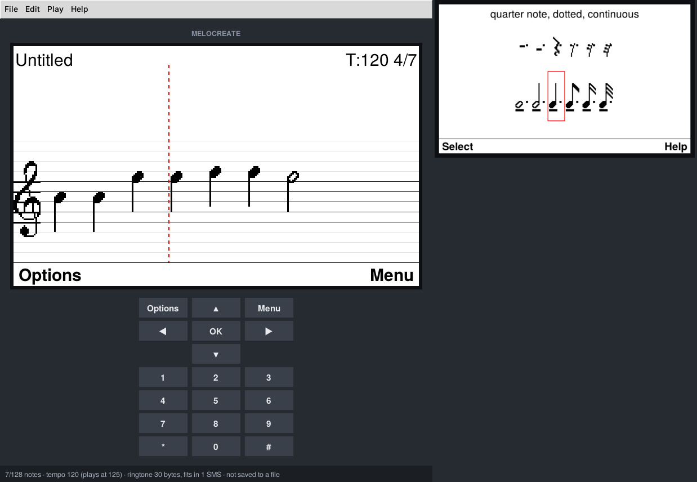

# MeloCreate — desktop edition (Python)

A Python/Tkinter recreation of **MeloCreate**, the ringtone composer for Nokia Series 40 phones (J2ME MIDP 1.0, 2002–2003).

The 2003 app was rebuilt from its compiled classes. The staff editor, the duration picker, the keypad controls, the note range, the save format and the Nokia Smart Messaging encoder all work the same way as on the phone. The notes, clefs and accidentals are drawn with the original sprite sheet (`allStaff.png`).

The SMS **Send** feature (Clickatell HTTP gateway) has been removed. Instead, a ringtone can be exported as a Nokia `.ott` file, an RTTTL string or a WAV file.



## Requirements

- Python 3.8 or newer, with Tkinter and Tk 8.6. Tkinter is included with the python.org installers for Windows and macOS. On Debian/Ubuntu, run `sudo apt install python3-tk`.
- No third-party packages.
- Sound uses whatever the system already has:
  - Windows: `winsound` (built in)
  - macOS: `afplay` (built in)
  - Linux: the first of `paplay`, `pw-play`, `aplay` or `ffplay` that is installed

  If none is found, the editor still works and you can use **File > Export WAV**.

## Running

```
python3 melocreate.py                 # new ringtone
python3 melocreate.py song.mcr        # open a saved ringtone
python3 melocreate.py tone.ott        # import a Nokia ringtone
python3 melocreate.py --zoom 2        # screen scale 1-6 (default 3)
```

## Using it

The window looks like the phone: a screen with two soft keys, a navigation pad and a 12-key keypad. You can click the on-screen keys or use the keyboard.

### Editor (the staff)

| Action | Phone key | Keyboard |
|---|---|---|
| Open the duration picker, which adds or changes the note | `5` (FIRE) | Enter, or double-click |
| Raise / lower the note by a semitone | `2` / `8` | ↑ / ↓, or the mouse wheel |
| Move between notes | `4` / `6` | ← / → |
| Insert an empty slot | hold `0` | Insert |
| Show sharps or flats | hold `#` | Edit menu |
| Treble / bass clef | hold `*` | Edit menu |
| First / last note | hold `1` / `7` | |
| Options list (Duration, Insert, Delete, Clear, Play, More, Help) | left soft key | F1 |
| Menu (Title, Tempo, Save, Load) | right soft key | F2 |
| Delete the note under the cursor | Options > Delete | Delete |
| Clear (backspace: delete the note before the cursor) | Options > Clear | Backspace |
| Play / stop | Options > Play | Space |

You can also click a note to select it. Each time you move to a note or change it, you hear it, as on the phone. You can turn this off in the **Play** menu.

To add a note, move past the last note with `6` (→) and press `5` (Enter). A new note takes its pitch from the previous note, as in the original. If there is no previous note, it starts on C.

The header line works like the phone's:
- It shows the title.
- After a move it briefly shows `N:` and the note. For example, `N:4C#` is a quarter-note C#, and `N:8.A` is a dotted eighth-note A.
- While the tune plays it shows `E:` and the elapsed seconds.

On the right is `T:` with the tempo, then the cursor position and the number of notes.

### Duration picker

The top row holds the rests and the bottom row the notes, from whole to 1/32.

| Action | Phone key | Keyboard |
|---|---|---|
| Choose | `2` `4` `6` `8` | arrows, or click |
| Cycle: plain → dotted → double-dotted → triplet | `#` | `#` or numpad `/` |
| Cycle: natural → continuous → staccato | `*` | `*` |
| Select and go back to the editor | `5` / Select | Enter, or click again |
| Cancel | | Esc |

### Range and notation

- Notes run from **A4 (440 Hz) to A7 (3520 Hz)** in semitone steps. This is the Smart Messaging range.
- As in the original, the staff is written **one octave below** the sounding pitch, so the tunes sit on the staff instead of above it.
- The bass clef only changes the display. It shows the notes two octaves lower again.
- Continuous notes are marked with a bar and staccato notes with a dot. Triplets get a small `3`.

## Files and storage

| What | Where / format |
|---|---|
| **Phone slots** (Menu > Save / Load) | `~/.melocreate/slots.json`, holding a list of the original record strings |
| **File > Save / Open** (`.mcr`) | One plain-text record, in the same format the phone wrote to its record store: `title;tempo;dur,directive,note,style;…` for all 128 slots (`-1` = empty) |
| **Export Nokia ringtone** (`.ott`) | Nokia Smart Messaging binary. **Import** reads `.ott` files too. |
| **Copy Smart Messaging hex** | The same bytes as uppercase hex on the clipboard. This is the payload the original sent by SMS (UDH `06050415810000`). |
| **Export RTTTL** | e.g. `Twinkle:d=4,o=5,b=125:4c6,4c6,4g6,…` for Arduino buzzers and similar projects. RTTTL has no triplets or double dots, so those notes are written as plain or single-dotted notes. |
| **Export WAV** | 22 kHz mono square wave, like a phone buzzer |

The status bar shows the size of the ringtone in bytes and whether it fits in one SMS (133 bytes).

### Tempo

You can type any tempo from 25 to 900. The ringtone format can only store the 32 values of the Smart Messaging tempo table (25, 28, 31, 35, 40 … 800, 900). The tune plays and exports at the first table value that is **equal to or higher than** your tempo. For example, 120 plays at 125. The status bar shows the tempo that will actually be used.

## Differences from the 2003 MIDlet

- **No Send.** The Clickatell username, API ID and password form is gone, along with all networking.
- **The ringtone carries its title.** The original sent a "temporary" song with no title. Exports now write a "basic" song that includes the title. `encode_ott(rt, with_title=False)` produces the original layout.
- **Instruction count fixed.** The original encoder declared one more instruction than it actually wrote. Apart from that one byte, the output is byte-for-byte identical to the 2003 `NokiaRingtone` class (checked by running the original class on the same tunes).
- **Long tunes.** If a tune needs more than 255 instructions, it is split across several Smart Messaging patterns. The original had no such limit check.
- **Gaps.** Moving off an empty slot left by Insert closes the gap without moving the cursor onto a different note.
- **Holding keys.** Holding `0` inserts one slot per press-and-hold, not one for every key repeat.
- **Additions:** a playhead that follows the tune, a wider screen (240 × 128 instead of 128 × 128) and mouse support.

## Code layout

All of it is in `melocreate.py`:

| Part | Original class |
|---|---|
| `Ringtone`: 128 slots, insert, delete, trim, record string | `GUIComposer.Data.Ringtone` |
| `encode_ott` / `decode_ott`, `BitWriter` / `BitReader` | `GUIComposer.Data.NokiaRingtone` |
| `to_rtttl` | new |
| `render_tune`, `AudioOut` | `GUIComposer.TonePlayer.NokiaTonePlayer` |
| `MeloCreate.draw_editor`, `draw_note`, `draw_glyph` | `GUIComposer.UI.Editor`, `GUIComposer.UI.Img` |
| `MeloCreate.open_duration`, `duration_select` | `GUIComposer.UI.DurationEdit` |
| Options / Menu / slot lists, help, alerts | `GUIComposer.UI.Menu`, `HelpDoc`, `TextEdit` |
| `load_slots` / `save_slots` | `GUIComposer.Data.Recorder` (RMS) |

## License

MIT, the same as the original repository.
