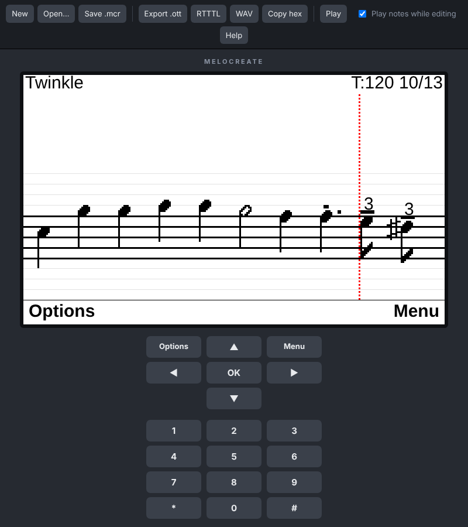

# MeloCreate — web edition

A browser recreation of **MeloCreate**, the ringtone composer for Nokia Series 40 phones (J2ME MIDP 1.0, 2002–2003). It is one self-contained `index.html` written in plain HTML, CSS and JavaScript, with no libraries, no build step and no server code.

It works the same way as the [Python desktop edition](../python/README.md): the staff editor, duration picker, keypad controls, note range, save format and Nokia Smart Messaging encoder follow the original MIDlet. The notes, clefs and accidentals are drawn with the original `allStaff.png` sprite sheet, which is built into the page.

The SMS **Send** feature (Clickatell) is not included. You can export the ringtone as a Nokia `.ott` file, an RTTTL string or a WAV file instead.

## Running

- **Locally:** open `index.html` in any current browser (Chrome, Edge, Firefox or Safari, on desktop or phone). No web server is needed.
- **GitHub Pages:** in the repository settings, go to **Pages** and deploy from the default branch. The app is then at `https://pangchi.github.io/melocreate/web/`.

Browsers start sound only after you interact with the page, so the first key, click or tap turns the audio on.

## Using it

The page looks like the phone: a screen with two soft keys, a navigation pad and a 12-key keypad. You can click or tap the on-screen keys (press and hold works too), or use the keyboard.

### Editor (the staff)

| Action | Phone key | Keyboard / mouse |
|---|---|---|
| Open the duration picker, which adds or changes the note | `5` (FIRE) | Enter, or double-click/tap the note |
| Raise / lower the note by a semitone | `2` / `8` | ↑ / ↓, or the mouse wheel |
| Move between notes | `4` / `6` | ← / →, or click a note |
| Insert an empty slot | hold `0` | Insert |
| Show sharps or flats | hold `#` | hold `#` |
| Treble / bass clef | hold `*` | hold `*` |
| First / last note | hold `1` / `7` | hold `1` / `7` |
| Options list (Duration, Insert, Delete, Clear, Play, More, Help) | left soft key | Q or F1 |
| Menu (Title, Tempo, Save, Load) | right soft key | W or F2 |
| Delete the note under the cursor | Options > Delete | Delete |
| Clear (backspace: delete the note before the cursor) | Options > Clear | Backspace |
| Play / stop | Options > Play | Space, or **Play** in the toolbar |

To add a note, move past the last note with `6` (→) and press `5` (Enter). A new note takes its pitch from the previous note, as in the original. If there is no previous note, it starts on C.

Each time you move to a note or change it, you hear it. You can turn this off with **Play notes while editing** in the toolbar.

The header line works like the phone's:
- It shows the title.
- After a move it briefly shows `N:` and the note. For example, `N:4C#` is a quarter-note C#.
- While the tune plays it shows `E:` and the elapsed seconds, and a highlight follows the note being played.

### Duration picker

The top row holds the rests and the bottom row the notes, from whole to 1/32.

| Action | Key |
|---|---|
| Choose | `2` `4` `6` `8`, arrows, or click/tap |
| Cycle: plain → dotted → double-dotted → triplet | `#` (or numpad `/`) |
| Cycle: natural → continuous → staccato | `*` |
| Select and go back to the editor | `5`, Enter, Select, or click the chosen symbol again |
| Cancel | Esc |

### Range and notation

- Notes run from **A4 (440 Hz) to A7 (3520 Hz)**, the Smart Messaging range.
- As in the original, the staff is written one octave below the sounding pitch.
- The bass clef only changes the display.

## Files and storage

| What | Where / format |
|---|---|
| **Work in progress** | Saved automatically in the browser (`localStorage`), so a reload or closed tab doesn't lose it |
| **Phone slots** (Menu > Save / Load) | The browser's `localStorage`, under `melocreate.slots`, holding a list of the original record strings. Slots stay in that browser on that device. Use **Save .mcr** for backups. |
| **Save .mcr / Open…** | One plain-text record in the format the phone wrote to its record store: `title;tempo;dur,directive,note,style;…` for 128 slots (`-1` = empty). The same files work in the Python edition. |
| **Export .ott / Open…** | Nokia Smart Messaging binary. You can also drag and drop a `.mcr` or `.ott` file onto the page. |
| **Copy hex** | The same bytes as uppercase hex, the payload the original sent by SMS. The clipboard needs the page served over `https` or `localhost`; when opened from a file, the hex appears in a box to copy instead. |
| **RTTTL** | e.g. `Twinkle:d=4,o=5,b=125:4c6,4c6,4g6,…`. Triplets and double dots are simplified, since RTTTL can't express them. |
| **WAV** | 22 kHz mono square wave, rendered offline with Web Audio |

The status bar shows the ringtone's size and whether it fits in one SMS (133 bytes).

### Tempo

You can type 25 to 900. The ringtone format stores only the 32 values of the Smart Messaging tempo table, so the tune plays and exports at the first table value **equal to or higher than** your tempo (120 plays at 125). The status bar shows the tempo that will be used.

## Differences from the 2003 MIDlet

These are the same as in the Python edition:

- **No Send.**
- **Exports carry the title** (a "basic" song). `MeloCreate.encodeOtt(tune, false)` gives the original title-less layout.
- **Correct instruction count.** The original declared one instruction too many. Otherwise the output is byte-for-byte identical to the 2003 `NokiaRingtone` class.
- **Long tunes** are split across several patterns.
- **Holding `0`** inserts one slot per hold.
- **Additions:** a playhead, a wider 240 × 128 screen, and mouse and touch input.

## For developers

Everything is in `index.html`, in sections that match the original classes:

| Section | Original class |
|---|---|
| `Ringtone` | `GUIComposer.Data.Ringtone` |
| `encodeOtt` / `decodeOtt` | `GUIComposer.Data.NokiaRingtone` |
| `scheduleTone`, `playTune`, `renderWav` (Web Audio) | `GUIComposer.TonePlayer.NokiaTonePlayer` |
| `drawEditor`, `drawNote`, `drawGlyph` | `GUIComposer.UI.Editor`, `GUIComposer.UI.Img` |
| `openDuration`, `durationSelect` | `GUIComposer.UI.DurationEdit` |
| `openOptions`, `openMenu`, `menuSave`, `menuLoad`, `showHelp` | `GUIComposer.UI.Menu`, `HelpDoc` |

The browser console exposes `window.MeloCreate` (`Ringtone`, `encodeOtt`, `decodeOtt`, `toRtttl`, `toHex`, `renderWav`, and `tune` for the current ringtone). The encoder, decoder, RTTTL export and record format were checked against the Python edition on the same test tunes and give identical output.

## License

MIT, the same as the original repository.
